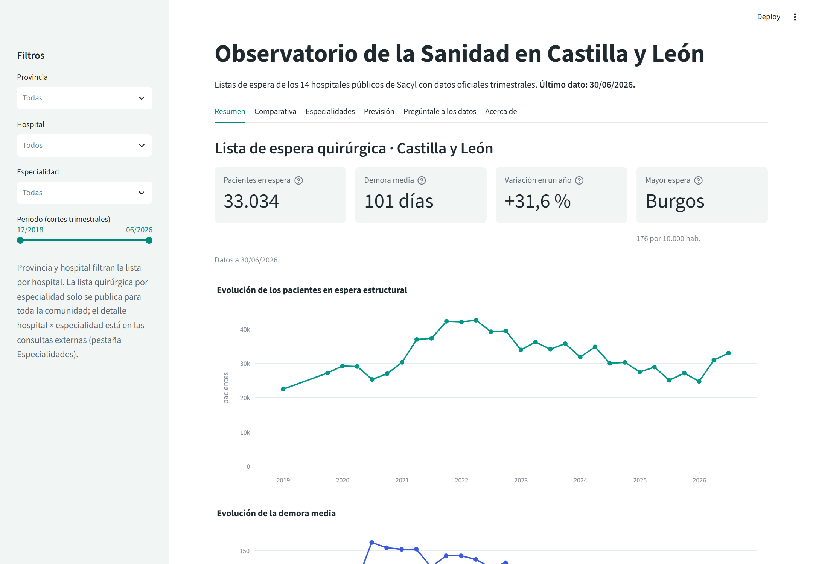
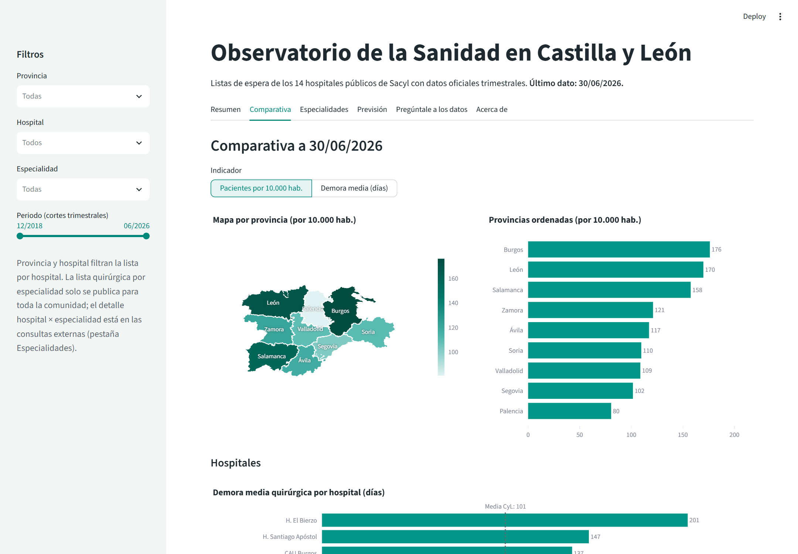
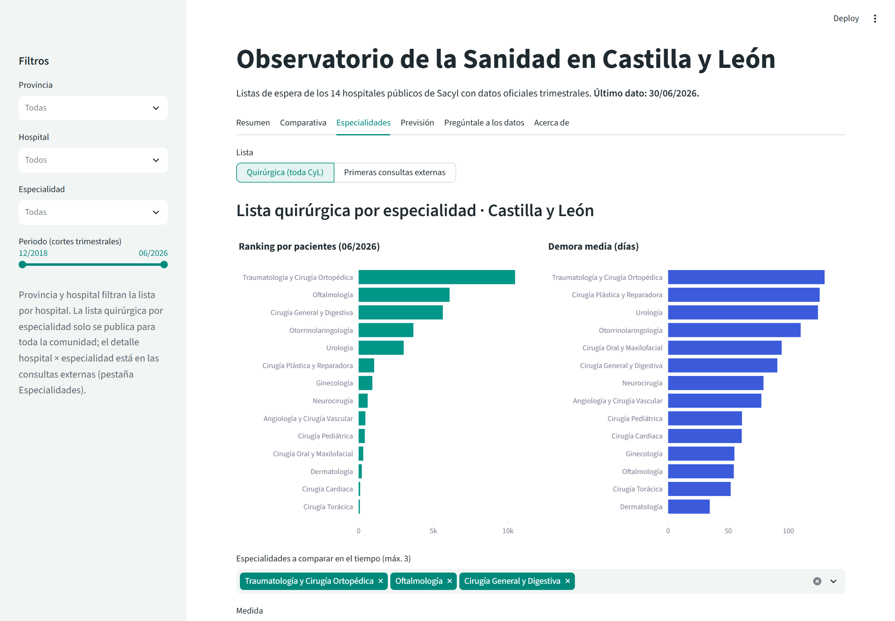
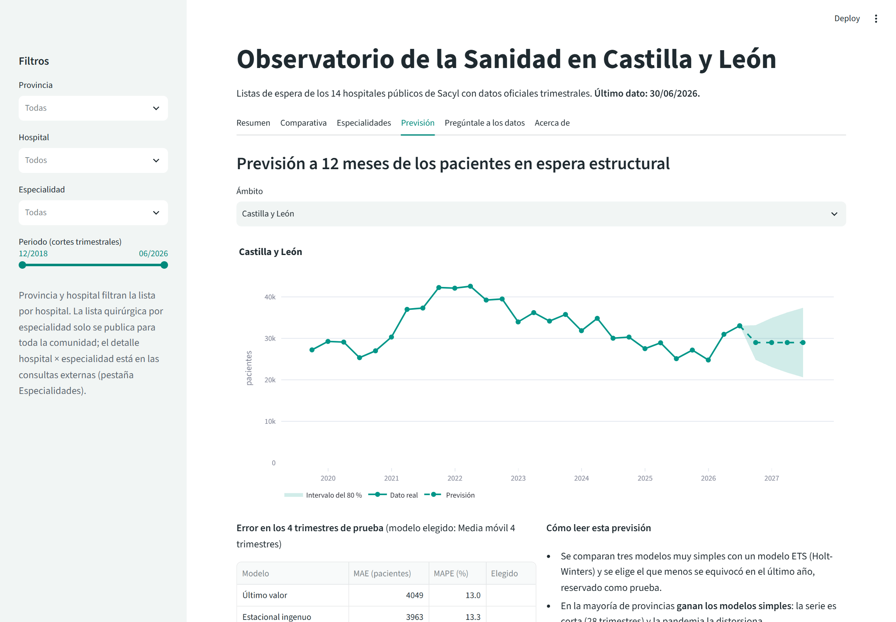
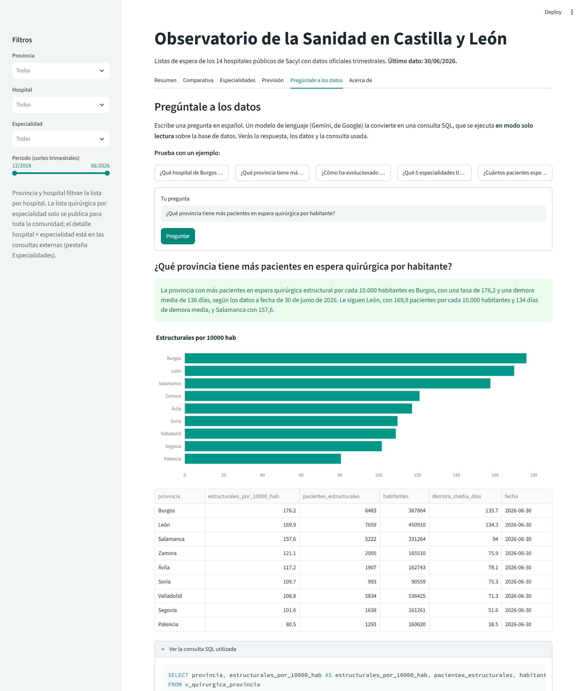
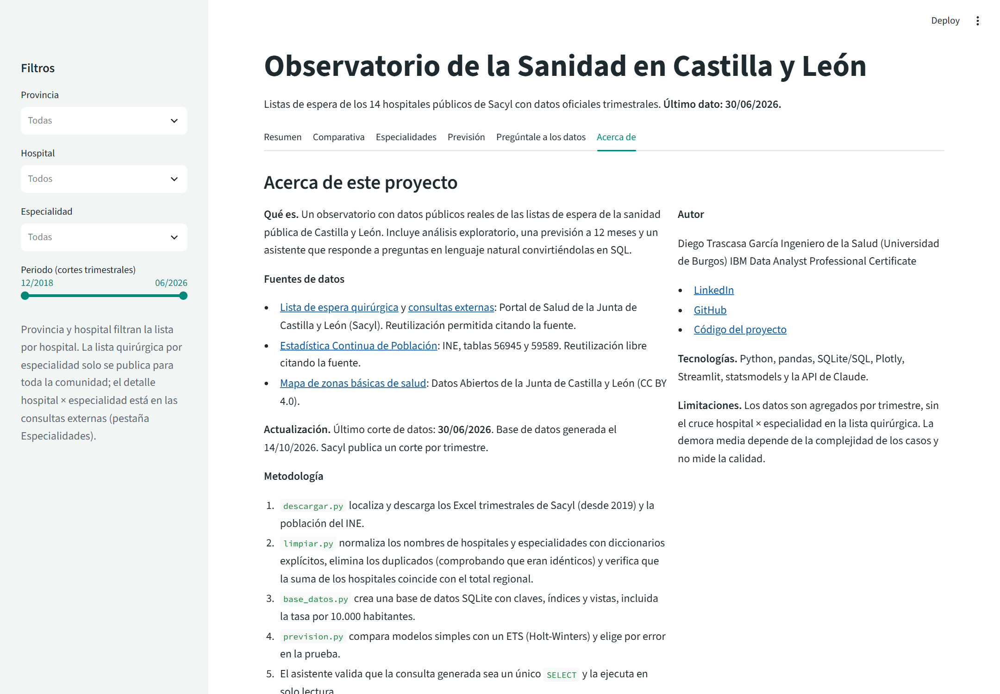
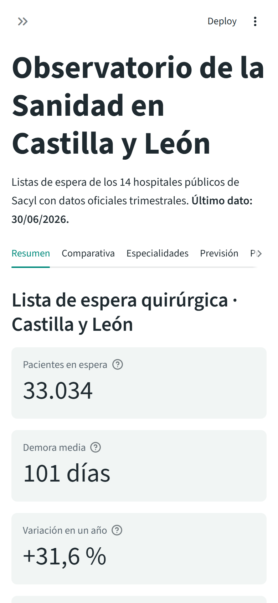
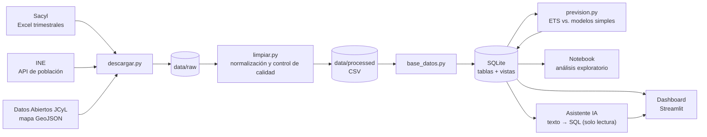

<div align="center">

# 🏥 Observatorio de la Sanidad en Castilla y León

**Dashboard interactivo con datos oficiales de las listas de espera de los 14 hospitales públicos de Castilla y León (2018-2026): análisis, previsión a 12 meses y un asistente de IA que responde preguntas convirtiéndolas en SQL.**

[](https://observatorio-sanidad-cyl-tmj3fejzr594gvoczadj5x.streamlit.app/)




</div>

<details>
<summary>🇬🇧 <b>English summary</b></summary>

<br>

**Healthcare data analysis project on surgical and outpatient waiting lists in Castilla y León (Spain).** A reproducible Python pipeline downloads 56 quarterly Excel files from the regional health service (Sacyl) plus population data from the national statistics office (INE), cleans and normalizes them with explicit quality checks (hospital totals match the official regional total in all 29 quarters), and loads them into a relational SQLite database with views such as waiting patients per 10,000 inhabitants. A narrated Jupyter notebook answers five business questions, an ETS (Holt-Winters) forecast is honestly benchmarked against naive baselines, and a Streamlit dashboard offers filters, a choropleth map and a text-to-SQL assistant (Gemini) that only runs validated, read-only `SELECT` queries. Key finding: the surgical waiting list grew 33% in the first half of 2026, and Burgos has the highest waiting rate per inhabitant (+29% vs. the regional average).

</details>

---

## Qué responde

| Pregunta | Respuesta con los datos (corte del 30/06/2026) |
|---|---|
| ¿Cómo evoluciona la lista de espera quirúrgica? | Tras el pico de la pandemia (**42.574** pacientes en marzo de 2022) bajó hasta **24.786** en diciembre de 2025, pero en 2026 **ha vuelto a subir un 33 % en seis meses**, hasta **33.034**, con 101 días de demora media. |
| ¿Cómo está Burgos frente al resto? | **Es la provincia con más espera por habitante: 176 pacientes por 10.000 habitantes, un 29 % más que la media (136).** También tiene la mayor demora provincial (136 días) y ha estado por encima de la media en los 29 trimestres. |
| ¿Qué especialidades esperan más? | **Traumatología** concentra el 32 % de la lista (10.479 pacientes, 130 días). En el último año, la que más empeora es **Urología** (+43 días). |
| ¿Hay estacionalidad? | **Sí:** la demora sube en el corte de septiembre en 5 de 5 años (+9,5 días de media), porque en verano hay menos actividad quirúrgica. |
| ¿Qué hospitales destacan? | **El Bierzo** tiene la mayor demora (201 días, +84 en un año). En el extremo contrario están el **CAU de Palencia** (38) y el **Clínico de Valladolid** (44). |
| ¿Qué pasará en los próximos 12 meses? | Previsión con intervalo del 80 %. El modelo ETS solo gana a los modelos simples en Burgos, y así se cuenta. |

## Capturas

| Comparativa (mapa y ranking) | Especialidades |
|---|---|
|  |  |
| **Previsión** | **Pregúntale a los datos (IA → SQL)** |
|  |  |
| **Acerca de** | **Móvil** |
|  |  |

## Arquitectura



Todo se regenera con **un solo comando**: `python ejecutar_todo.py`.

## Lo más destacable a nivel técnico

- **Descarga automatizada y robusta:** el script recorre el histórico de Sacyl y encuentra cada Excel, con reintentos y sin desactivar la verificación SSL (usa `truststore`).
- **Limpieza con controles de calidad:**
  - Diccionarios explícitos para unificar los nombres de hospitales y especialidades. Si aparece un nombre nuevo, el script falla a propósito.
  - Duplicados eliminados tras comprobar que eran idénticos.
  - Comprobación de que la suma de los hospitales es igual al total regional publicado en los 29 cortes.
  - Un cambio de formato en 2022 detectado y resuelto.
- **SQL:** esquema en estrella con claves primarias y foráneas, `CHECK`, índices y vistas. Una de ellas calcula la tasa por 10.000 habitantes con la población del INE de cada trimestre y una demora provincial ponderada.
- **Previsión honesta:** el ETS (Holt-Winters) se compara con tres modelos de referencia en un periodo de prueba (MAE y MAPE), y se elige el que menos se equivoca aunque sea el más simple.
- **Asistente de IA seguro:** el modelo solo genera SQL. La consulta pasa por un validador (un único `SELECT`), se ejecuta en una conexión SQLite de solo lectura con un autorizador que bloquea cualquier escritura y se limita a 500 filas. Se muestra la consulta usada.
- **64 tests con pytest:** integridad de la base de datos, previsión y seguridad del asistente.

## Tecnologías

Python 3.12 · pandas · SQLite / SQL · Jupyter · Plotly · Streamlit · statsmodels · shapely · API de Gemini (Google, plan gratuito) · pytest · git y GitHub · Streamlit Community Cloud

## Estructura

```
observatorio-sanidad-cyl/
├── ejecutar_todo.py          Pipeline completo: descarga → limpieza → SQLite → previsión
├── app/dashboard.py          Dashboard de Streamlit
├── src/
│   ├── descargar.py          Descarga de Sacyl, INE y Datos Abiertos JCyL
│   ├── limpiar.py            Limpieza, normalización y mapa de provincias
│   ├── base_datos.py         Esquema, carga y vistas de SQLite
│   ├── prevision.py          Modelos de previsión y validación
│   ├── asistente.py          Texto a SQL con validación de seguridad
│   └── estilo.py             Paleta y plantilla común de los gráficos
├── notebooks/analisis_exploratorio.ipynb
├── tests/                    Tests con pytest
├── data/
│   ├── raw/                  Datos originales descargados
│   ├── processed/            CSV limpios y GeoJSON de provincias
│   └── sanidad_cyl.db        Base de datos SQLite
└── docs/
    ├── BITACORA.md           Decisiones tomadas en cada fase
    ├── DICCIONARIO_DATOS.md  Qué significa cada tabla y columna
    └── capturas/
```

## Cómo ejecutarlo en local

Necesitas Python 3.11 o superior y git.

```bash
git clone https://github.com/diegotraski/observatorio-sanidad-cyl.git
cd observatorio-sanidad-cyl
python -m venv venv
venv\Scripts\activate            # en Linux/Mac: source venv/bin/activate
pip install -r requirements-dev.txt
```

1. **(Opcional) Regenerar los datos desde cero.** La base de datos ya viene incluida.
   ```bash
   python ejecutar_todo.py
   ```
2. **(Opcional) Activar el asistente de IA.** Copia `.env.example` como `.env` y pega tu clave gratuita de [Google AI Studio](https://aistudio.google.com/apikey) en `GEMINI_API_KEY`.
3. **Arrancar el dashboard:**
   ```bash
   streamlit run app/dashboard.py
   ```
4. **Pasar los tests:**
   ```bash
   pytest
   ```

## Fuentes de datos y licencias

| Fuente | Datos | Licencia |
|---|---|---|
| [Portal de Salud de la Junta de Castilla y León (Sacyl)](https://www.saludcastillayleon.es/es/leq-total-ce-pdt/historico) | Lista de espera quirúrgica y de consultas externas, trimestral, por hospital y especialidad (sep-2019 a jun-2026, más dic-2018) | Reutilización permitida citando la fuente |
| [INE · Estadística Continua de Población](https://www.ine.es/dynt3/inebase/es/index.htm?padre=10358) | Población residente por provincia (tablas 56945 y 59589) | Reutilización libre citando la fuente |
| [Datos Abiertos de la Junta de Castilla y León](https://analisis.datosabiertos.jcyl.es/explore/dataset/mapas-de-areas-de-salud-de-castilla-y-leon/) | Mapa de zonas básicas de salud | CC BY 4.0 |

Fuente de los datos: Junta de Castilla y León (Sacyl) e INE. Elaboración propia.

## Limitaciones

- Los datos son **agregados y trimestrales**: una foto del último día de cada trimestre, sin datos por paciente.
- Sacyl **no publica el cruce hospital × especialidad** para la lista quirúrgica. Ese detalle solo existe para las consultas externas.
- La serie continua empieza en septiembre de 2019: marzo y junio de 2019 no están publicados en Excel.
- En las consultas externas hay un salto del +33 % en septiembre de 2022 que apunta a un **cambio en el registro**.
- La **demora media no mide la calidad**: depende de la complejidad de los casos de cada hospital.
- La previsión es una extrapolación estadística con pocos datos: no conoce planes de choque, plantillas ni huelgas.
- Las respuestas del asistente de IA pueden equivocarse. Por eso se muestran siempre la consulta SQL y los datos.

Más detalle en la [bitácora](docs/BITACORA.md) y el [diccionario de datos](docs/DICCIONARIO_DATOS.md).

## Autor

**Diego Trascasa García**: Ingeniero de la Salud (Universidad de Burgos) · IBM Data Analyst Professional Certificate

[LinkedIn](https://www.linkedin.com/in/diego-trascasa-garc%C3%ADa-b171382b2/) · [GitHub](https://github.com/diegotraski)

## Licencia

Código bajo licencia [MIT](LICENSE). Los datos pertenecen a sus fuentes (Sacyl, INE y Junta de Castilla y León) y se reutilizan según sus condiciones, citadas arriba.
